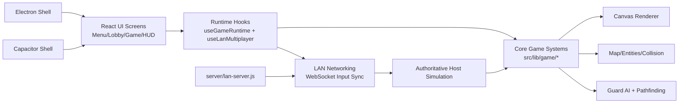

# Museum Break

Co-op stealth heist game built with React + Vite.

Players steal artifacts, avoid guards/cameras/lasers, solve map puzzles, and escape via the van before lockdown.

## Tech Stack

- Frontend: React, Vite, Canvas rendering
- Game systems: custom game loop, collision, guard AI/pathfinding (`pathfinding`)
- LAN multiplayer: WebSocket (authoritative host, input-sync networking)
- Desktop packaging: Electron + electron-builder
- Mobile packaging: Capacitor (Android/iOS)
- Testing: Vitest + coverage, GitHub Actions CI

## Repository Layout

- `src/pages/Game.jsx` - top-level game screen composition
- `src/lib/game/*` - core gameplay systems (`gameLoop`, `entityLogic`, `playerLogic`, `collision`, renderer, map data)
- `src/hooks/useGameRuntime.js` - runtime orchestration (loop, resize, render)
- `src/hooks/useLanMultiplayer.js` - LAN session/lobby/network orchestration
- `server/lan-server.js` - LAN WebSocket host server
- `electron/` - desktop runtime shell
- `android/`, `ios/`, `capacitor.config.ts` - mobile runtime scaffolding
- `tests/` - unit + integration test suites

## Architecture



## Prerequisites

- Node.js 20+
- npm 10+

For mobile packaging:
- Android Studio / SDK for Android builds
- Xcode for iOS builds (macOS only)

## Install

```bash
npm install
```

## Run (Web Dev)

```bash
npm run dev
```

Open the shown URL (typically `http://localhost:5173`).

## LAN Multiplayer (MVP)

### Option A: Host helper

```bash
npm run lan:host
```

This starts web dev + LAN server for host machine.

### Option B: Manual

Terminal 1:
```bash
npm run dev
```

Terminal 2:
```bash
npm run lan:server
```

In game:
1. Open `LAN HOST / JOIN`
2. Host creates room and shares code
3. Client joins using room code (or discovered room)

### Platform behavior

- Desktop packaged apps (Windows/macOS): embedded LAN server auto-start is supported.
- Mobile apps (Android/iOS): players can join LAN sessions, but mobile auto-host is not supported in the same way due to OS background/network restrictions.

## Build (Web)

```bash
npm run build
```

## Desktop (Electron)

Dev mode:
```bash
npm run desktop:dev
```

Windows installer build:
```bash
npm run desktop:dist:win
```

Output goes to `release/`.

## Mobile (Capacitor)

Sync web assets into native projects:
```bash
npm run mobile:sync
```

Open Android project:
```bash
npm run mobile:open:android
```

Open iOS project:
```bash
npm run mobile:open:ios
```

## Tests

Run in watch mode:
```bash
npm run test
```

Run once with coverage:
```bash
npm run test:run
```

CI runs the same test command via GitHub Actions.

## Notes for Contributors

- Networking model is host-authoritative with **input sync**, not full-state sync.
- Game objects are not scaled with window size; camera adjusts viewport instead.
- `release/` is build output (not source of truth).
- Keep gameplay logic changes inside `src/lib/game/*` and cover with tests under `tests/`.

## License

This project is licensed under the MIT License. See [LICENSE](./LICENSE).
