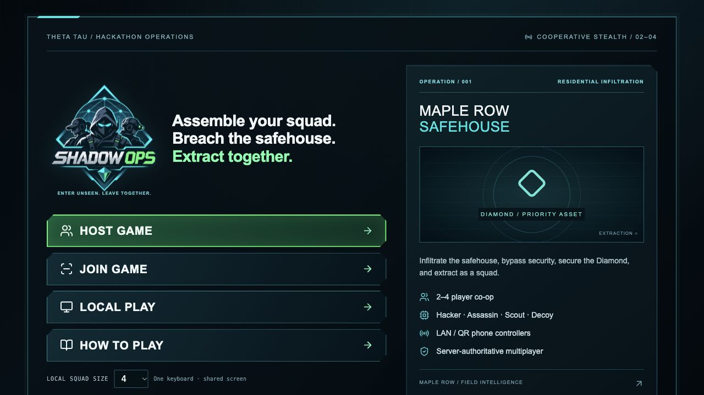
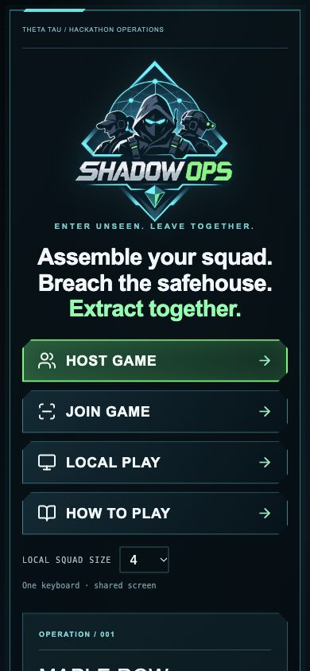
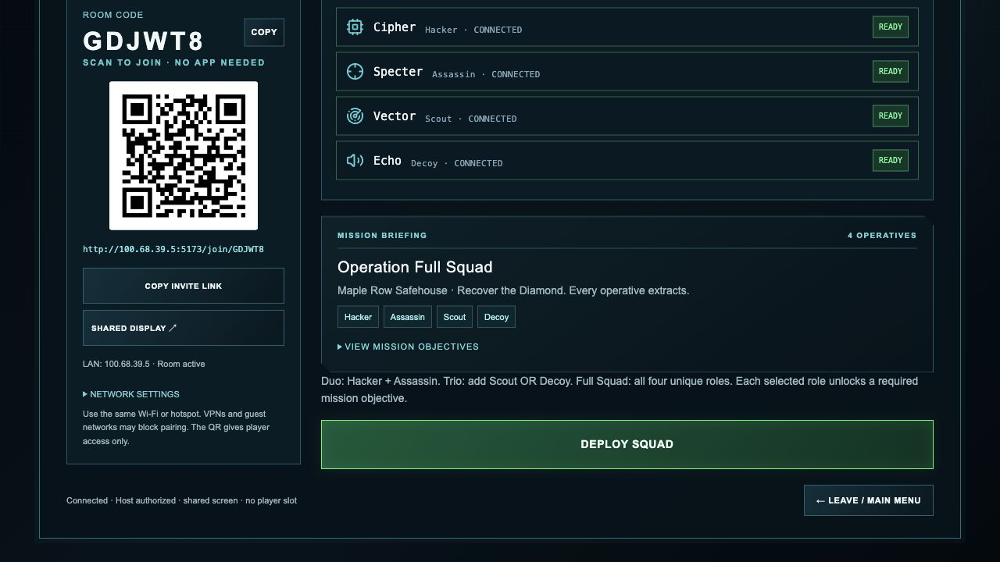
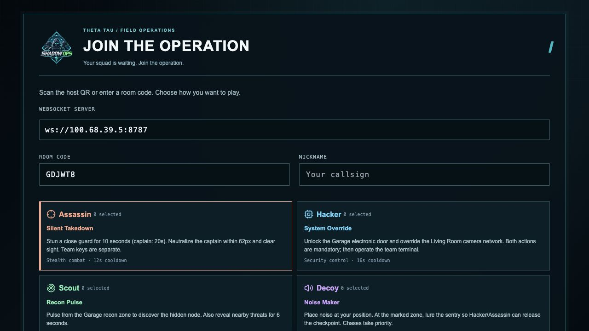
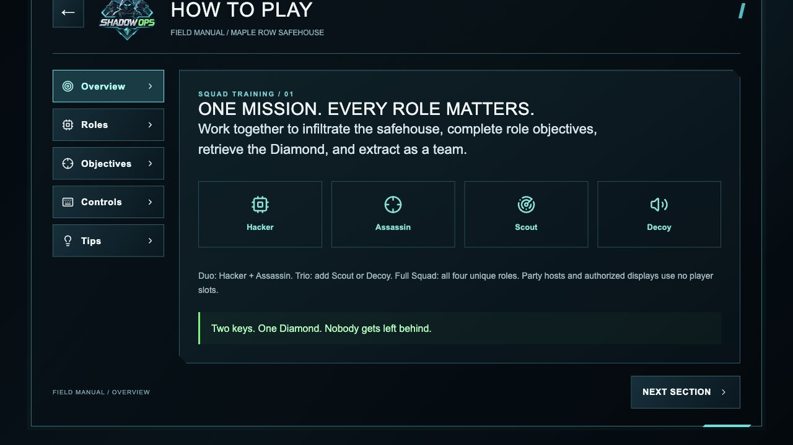
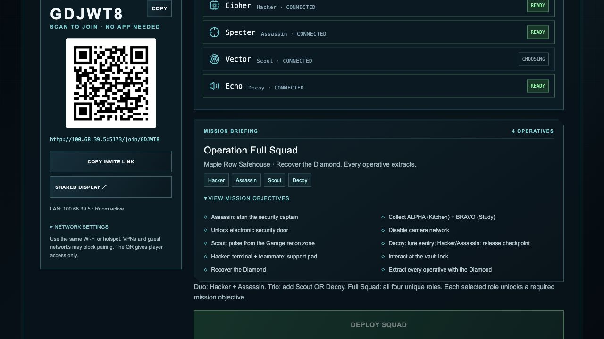
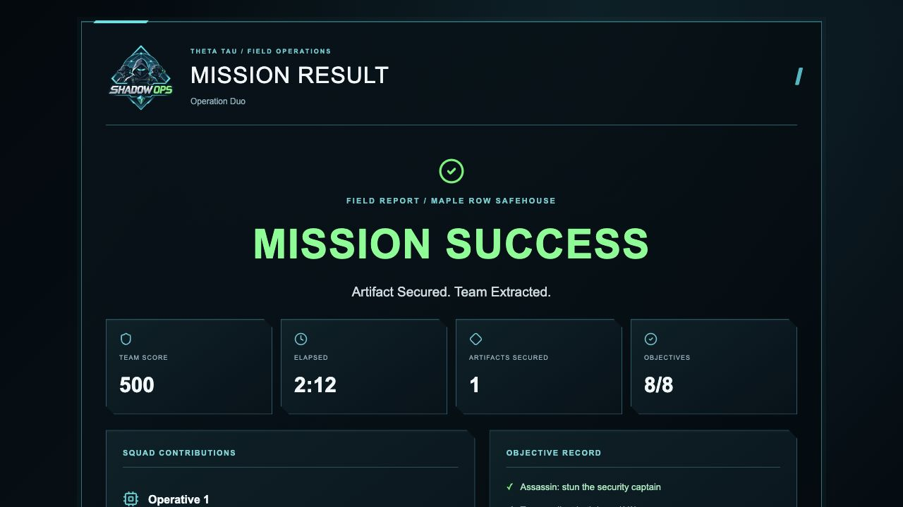
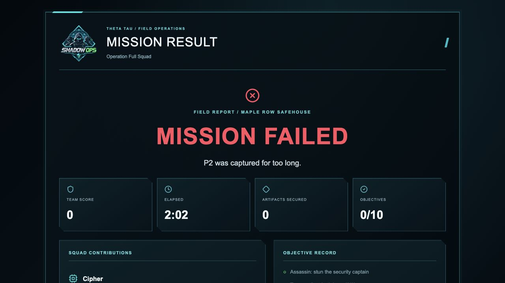
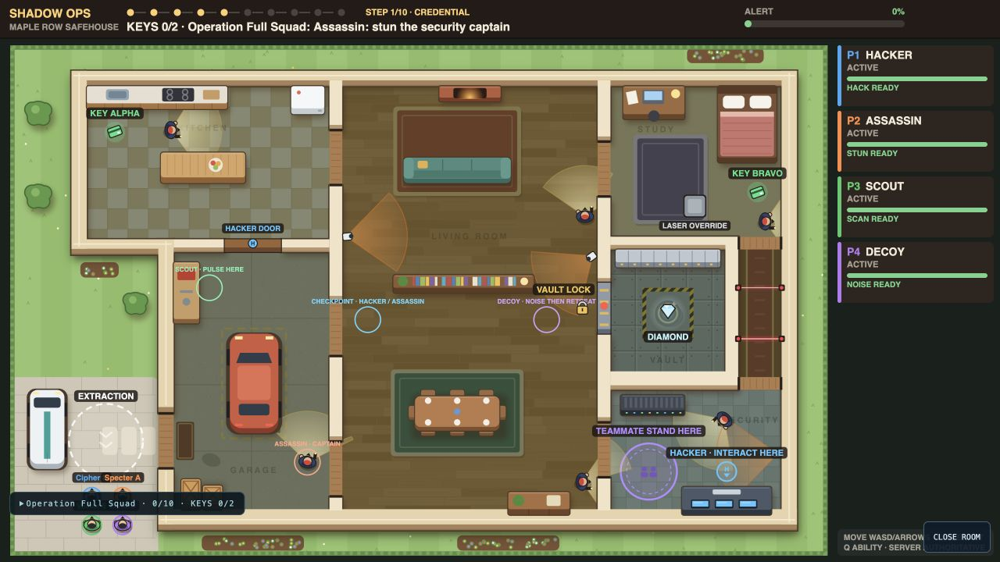

# Shadow Ops UI 3

## Interface

The supplied official logo is losslessly compressed and reused through `Logo`. `CommandUI` provides shared headers, role icons and an abstract mission information graphic. It does not depict or replace the playable map.

`MenuScreen`, `LobbyScreen`, `PartyInvite`, `RoleCards`, `InstructionsScreen`, `MissionBriefing` and `ResultScreen` use scoped tactical styles: navy panels, cyan borders, green actions, restrained red failure states and visible keyboard focus. Reduced-motion preferences disable decorative transitions. Menus own their vertical scrolling, including landscape phones; the Canvas and HUD do not receive these styles.

Desktop navigation uses two columns. Narrow screens stack panels, keeping all four primary actions on the first portrait viewport. Room and invite copy actions, actual QR generation, role selection, readiness, composition validation, reconnection, authorized displays and host-only room reset retain the existing networking paths. Briefings derive objectives from the real mission configuration. Results use real contributions, objective progress, elapsed time, score and failure reason; zero contributions do not create achievements.

## Gameplay scope

The only gameplay source change relative to the integrated baseline is BRAVO's spawn in `safehouse.js`: Garage (312, 440) → Study (1170, 230). ALPHA, room geometry, furniture, artwork, guard behavior, camera, HUD, role mechanics and protocols are untouched. Tests verify that BRAVO is on passable floor and that exactly two shared keys exist. The live mission driver follows real movement and interaction inputs to collect the relocated key and complete all four supported compositions.

This branch builds on the shared-key/security work in PR #7 and incorporates main's teammate guard improvements (PR #8). PR #7 remains a prerequisite while open; the UI commit itself does not introduce those gameplay systems.

## Verification

- `npm ci` completed without dependency changes.
- Full `npm run test:run`: 156 tests across 15 suites passed, including Duo, Trio Scout, Trio Decoy and Full Squad live mission completion with the Study key.
- ESLint, production build and asset audit passed.
- Browser checks: all main navigation actions, keyboard activation, manual tabs, real four-player joining, role changes clearing readiness, blocked invalid composition, readiness/deployment, refreshed player reconnection, authorized display without player slot, phone/game-view switching, actual live failure and host replay retaining roster.
- Actual advertised LAN invitation QR decoded to the same visible join URL. Room-code and invite-link clipboard actions were verified.
- Responsive browser frames: portrait 390×844 and landscape 844×390; no horizontal overflow and vertically scrollable content.
- Success screenshot renders an actual winning live-simulation snapshot in a temporary preview. Failure screenshot is from a real browser/server mission. Temporary preview files are excluded from the repository.
- Browser clients ran on one computer; physical phones and cross-device Wi-Fi were not tested. Existing dependency advisories were not changed by this UI task.

## Screenshots

